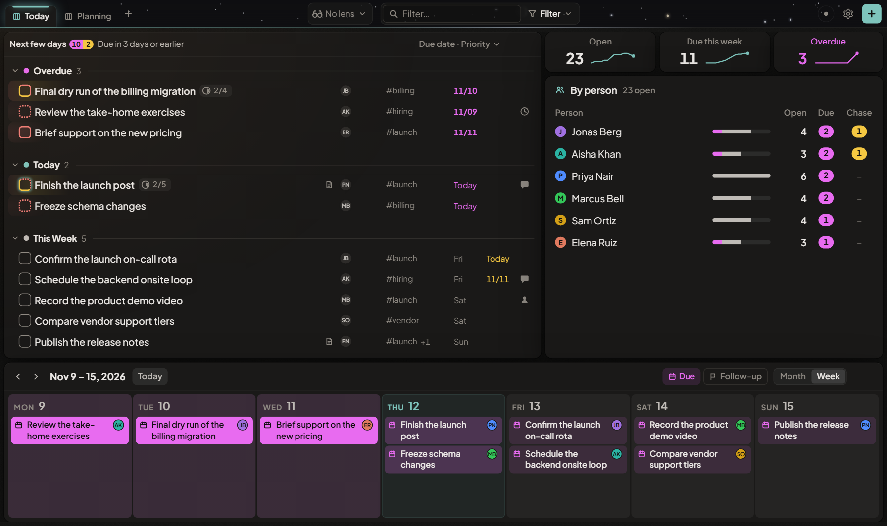
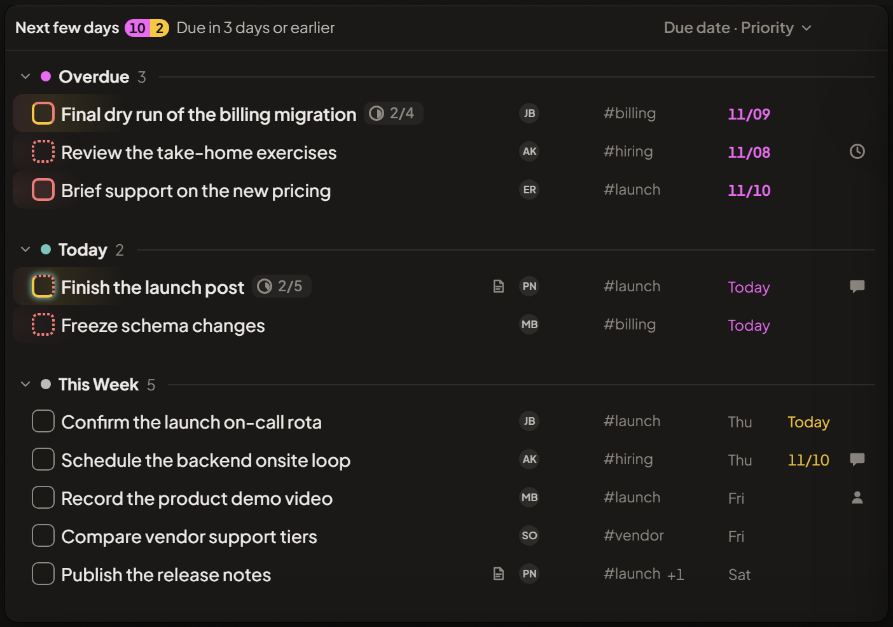
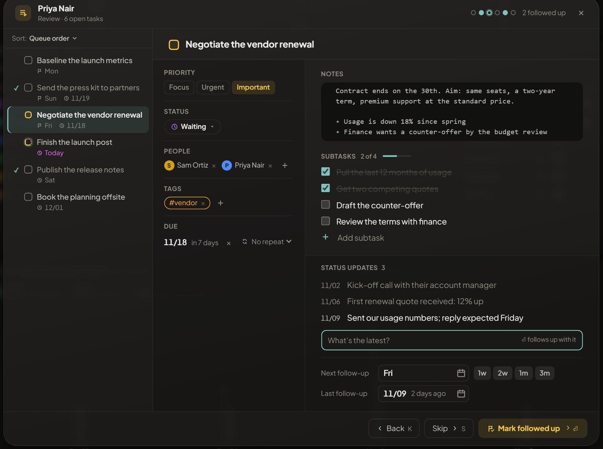
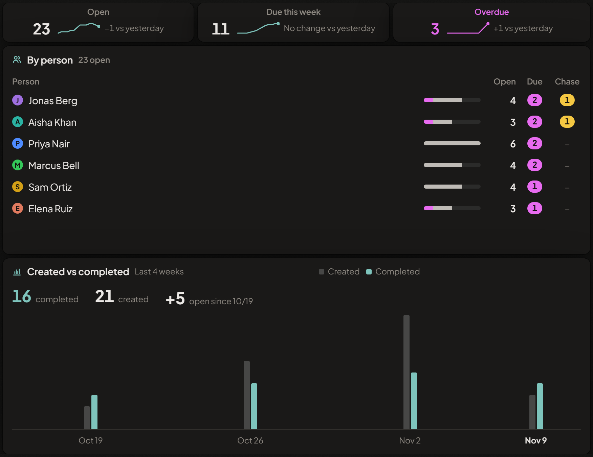
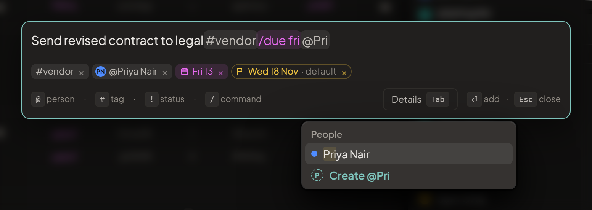

# TODO2

**A task manager for people who track a lot of work across a lot of people — and want all of it on one screen, on their own device.**

Lists, a calendar and at-a-glance numbers sit side by side in a workspace you arrange yourself. Your tasks never leave your browser: no account, no server.

**[Open TODO2](https://aerogeek217.github.io/TODO2/)** · [Download the offline file](https://aerogeek217.github.io/TODO2/todo2.html)



## Why TODO2

- **Yours alone.** Everything is stored in your browser and works offline. There is nothing to sign up for, and your tasks are never sent anywhere.
- **One screen, your layout.** Split the workspace into cells and put a list, a calendar, a chart or notes in each. Save as many layouts as you need and switch between them.
- **Built for following up.** Every task can have people, a next follow-up date and dated status updates, so "what did we last hear, and when do I ask again?" always has an answer.

## A closer look

### Lists that stay readable

Filter, group and sort each list its own way. Rows stay quiet until something needs you: colour is saved for what is overdue, due soon or waiting on a follow-up.



### Everything about a task, and a way to walk through them

A task holds its priority, status, people, tags and due date beside its notes, a checklist and a dated log of status updates. The Review widget steps through one person's tasks, or any filter you type, a card at a time: type what you learned, press Enter, and the task is marked followed up and the next card opens.



### Numbers and charts from your own filters

Count anything you can filter. Break your open work down by person, tag, status or priority, and click any number to see the tasks behind it.



### Type it the way you'd say it

Press `Ctrl` + `Space` anywhere and type. `@` adds a person, `#` a tag, `!` a status, and `/due fri` a due date, each turning into a chip as you type.



### And also

- A week and month **calendar** you can drag tasks onto
- A **Neglect map** of what is slipping, and free-form **notes** that turn into tasks
- **Lenses**: named filters you switch on from the top bar to narrow the whole screen
- **Check-ins**: copy a status request for each person from their open tasks into your own message, then paste the reply back in
- A **command palette** (`Ctrl` + `K`) and editable keyboard shortcuts
- **Recurring tasks**, **undo** for nearly everything, dark and light themes, and a phone layout

## Get started

| | |
|---|---|
| **Online** | Open **[aerogeek217.github.io/TODO2](https://aerogeek217.github.io/TODO2/)**. Your tasks are saved in that browser. |
| **Offline** | Download **[todo2.html](https://aerogeek217.github.io/TODO2/todo2.html)** and open it. It is a single file that makes no network requests. |

**Keeping your data safe.** TODO2 takes a backup inside the browser every day. For a copy outside the browser, export to JSON or Markdown at any time, or (in Chrome or Edge) connect a sync file in Settings and TODO2 keeps that file up to date. Put the file in a synced folder to use it on more than one computer.

## Development

Requires Node 22.13 or later.

```
npm install
npm run dev
```

The dev server runs on `http://localhost:5180`.

| Command | What it does |
|---|---|
| `npm run build` | Lints, then builds both outputs into `dist/`: `index.html` (online) and `todo2.html` (offline, single file) |
| `npm test` | Unit and component tests (Vitest) |
| `npm run test:e2e` | Browser tests (Playwright) |
| `npm run lint` | ESLint |

Built with React 19, TypeScript, Vite, Zustand, Dexie (IndexedDB), dnd-kit, CodeMirror and React Router. Architecture notes are in [docs/ARCHITECTURE.md](docs/ARCHITECTURE.md).

## License

[MIT](LICENSE)
